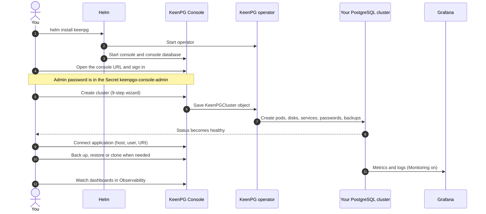
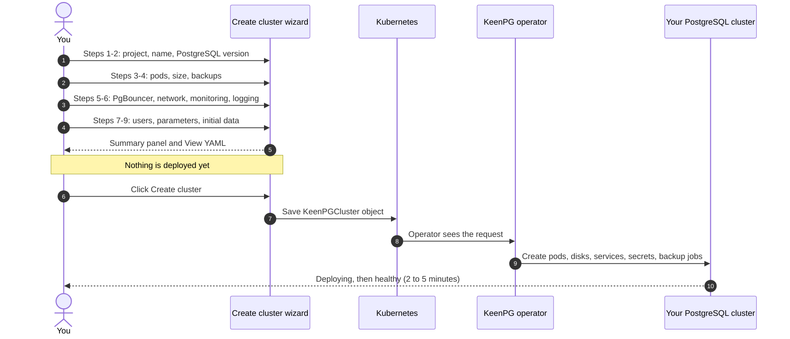

# KeenPG Console

> The **KeenPG console** is a web page for running PostgreSQL on Kubernetes and OpenShift. From your browser you can create databases, connect applications, take backups and restore them, run SQL on the primary or on a replica, and watch every database on Grafana dashboards. You never need to write YAML.



This page explains every part of the console in simple words, with screenshots.

---

## Contents

| Getting Started | Cluster Management | Data & Operations | Administration & Reference |
| :--- | :--- | :--- | :--- |
| [How the console works](#how-the-console-works) | [Home](#home) | [SQL Editor](#sql-editor) | [Users and access](#users-and-access) |
| [Words you will see](#words-you-will-see) | [Create a cluster](#create-a-cluster) | [Databases](#databases) | [Other pages](#other-pages) |
| [Install with Helm](#install-with-helm) | [Clusters list](#clusters-list) | [Connect your application](#connect-your-application) | [Upgrade the console](#upgrade-the-console) |
| [Sign in](#sign-in) | [Inside a cluster](#inside-a-cluster) | [Backup and restore](#backup-and-restore) | [Common tasks](#common-tasks) |
| [HTTPS and the certificate](#https-and-the-certificate) | [Monitoring and logging](#monitoring-and-logging) | [Migration](#migration) | [Troubleshooting](#troubleshooting) |
| [The screen layout](#the-screen-layout) | [Observability](#observability) / [Discovery](#discovery) | — | [Be careful](#be-careful) |

---

## How the console works

```text
You (browser) ──HTTPS──► KeenPG console ──► Kubernetes ──► KeenPG operator ──► your PostgreSQL clusters
```

1. **You** fill a form or press a button in the console.
2. **The console** checks that you are allowed to do this. It then saves your request in Kubernetes as a `KeenPGCluster` object and writes an entry in the audit log.
3. **The KeenPG operator**, a program running inside your Kubernetes, sees the request. It creates everything the database needs: pods, disks, network services, passwords, certificates and backup jobs.
4. **The operator keeps watching.** If a pod crashes, a disk is lost or someone deletes a service by mistake, the operator puts it back.

Why this matters:

- **The console and the command line always agree.** For clusters, backups and settings, the console only writes the same objects you could write with `kubectl`. Only the **SQL Editor** and **Databases** pages talk to PostgreSQL directly, like any SQL tool.
- **Your databases don't depend on the console.** If the console stops, your databases keep running.
- **Your databases don't depend on the operator either.** If the operator stops, they keep running and failover still works. Only new changes wait until it is back.

---
## Words you will see

<table>
  <thead>
    <tr>
      <th align="left">Category</th>
      <th align="left">Word</th>
      <th align="left">Meaning</th>
    </tr>
  </thead>
  <tbody>
    <tr>
      <td rowspan="4"><strong>Architecture</strong></td>
      <td><strong>Project</strong></td>
      <td>A group of databases. In Kubernetes this is a <em>namespace</em>, for example <code>apps</code> or <code>analytics</code>. <strong>All projects</strong> shows every project at once.</td>
    </tr>
    <tr>
      <td><strong>Cluster</strong></td>
      <td>One PostgreSQL database service: one primary and its replicas.</td>
    </tr>
    <tr>
      <td><strong>Primary</strong> <em>(also leader)</em></td>
      <td>The main server. All writes go here.</td>
    </tr>
    <tr>
      <td><strong>Replica</strong> <em>(also standby)</em></td>
      <td>A live copy of the primary. It can serve reads and takes over if the primary fails.</td>
    </tr>
    <tr>
      <td rowspan="5"><strong>High Availability</strong></td>
      <td><strong>Sync standby</strong></td>
      <td>A replica that confirms every write before the primary says "done", so no data is lost if the primary fails.</td>
    </tr>
    <tr>
      <td><strong>Failover</strong></td>
      <td>A replica becomes the primary <strong>automatically</strong> because the primary stopped.</td>
    </tr>
    <tr>
      <td><strong>Switchover</strong></td>
      <td>You move the primary role to a replica <strong>on purpose</strong>, for example before maintenance.</td>
    </tr>
    <tr>
      <td><strong>Lag</strong></td>
      <td>How far a replica is behind the primary. <code>0 B</code> means fully up to date.</td>
    </tr>
    <tr>
      <td><strong>Patroni</strong></td>
      <td>The tool inside each pod that chooses the primary and handles failover.</td>
    </tr>
    <tr></tr>
    <tr>
      <td rowspan="3"><strong>Backup &amp; Restore</strong></td>
      <td><strong>pgBackRest</strong></td>
      <td>The backup tool.</td>
    </tr>
    <tr>
      <td><strong>Repository (repo)</strong></td>
      <td>Where backups are kept: a disk inside Kubernetes, or object storage (S3, GCS, Azure).</td>
    </tr>
    <tr>
      <td><strong>Point-in-time restore</strong></td>
      <td>Restoring a database to an exact moment, for example "yesterday at 10:15".</td>
    </tr>
    <tr></tr>
    <tr>
      <td rowspan="2"><strong>Connection &amp; Security</strong></td>
      <td><strong>PgBouncer</strong></td>
      <td>A connection pooler. Many application connections share a few database connections.</td>
    </tr>
    <tr>
      <td><strong>Secret</strong></td>
      <td>A safe place in Kubernetes for passwords, keys and certificates.</td>
    </tr>
    <tr>
      <td rowspan="2"><strong>Observability</strong></td>
      <td><strong>Collector</strong></td>
      <td>A small helper container added to each database pod when <strong>Monitoring</strong> is on. It collects metrics and, with <strong>Logging</strong>, the logs.</td>
    </tr>
    <tr>
      <td><strong>Prometheus / Loki / Grafana</strong></td>
      <td>Prometheus stores the metrics, Loki stores the logs, Grafana shows both as dashboards.</td>
    </tr>
  </tbody>
</table>

---

## Install with Helm

> [!NOTE]
> **Skip this part** if KeenPG is already installed for you.

**Step 1 — Install the chart**  
Run this from the folder that holds the chart. It installs everything: the operator, the console and the console's own database.

```bash
helm install keenpg ./keenpg-operator -n keenpg-operator --create-namespace
```

Wait until all pods are **Running**:

```bash
kubectl -n keenpg-operator get pods
```

```text
NAME                                READY   STATUS    RESTARTS   AGE
keenpgo-7b8d8dcc4f-tjnht            1/1     Running   0          2m
keenpgo-console-6797b94dc-rdl5j     1/1     Running   0          2m
keenpgo-console-db-0                1/1     Running   0          2m
```

## Open the console

The console service is only reachable inside Kubernetes. To open it from your browser, change the service to **NodePort**:

```bash
kubectl -n keenpg-operator patch svc keenpgo-console -p '{"spec":{"type":"NodePort"}}'
kubectl -n keenpg-operator get svc keenpgo-console
```

```text
NAME              TYPE       CLUSTER-IP     EXTERNAL-IP   PORT(S)                      AGE
keenpgo-console   NodePort   10.96.120.15   <none>        80:31847/TCP,443:30512/TCP   5m
```

| Browser URL | Example | Minikube Tip |
| :--- | :--- | :--- |
| `https://<node IP>:<node port>` | `https://192.168.49.2:30512` | `minikube ip` gives the node IP |

> [!NOTE]
> The first time, the browser warns that the certificate is not trusted. That is expected: the console made its own certificate. Click **Advanced → Continue**, or see [HTTPS and the certificate](#https-and-the-certificate).

---

### Optional: dashboards and logs

Install these once if you want the **Observability › Dashboards** page and the **Monitoring** and **Logging** switches:

```bash
kubectl apply -k config/monitoring      # Prometheus, Grafana, Alertmanager
kubectl apply -k config/logging         # Loki, only if you want logs
```

---

## Sign in


## Console Access & User Management

Access the KeenPGo Console through your browser using the console URL.

### 1. Login

1. Open the console URL in your browser.
2. Enter your **username** and **password**.
3. Click **Sign In**.

### 2. Initial Admin Credentials

Helm automatically generates a random password for the `admin` user and stores the credentials in the Kubernetes Secret `keenpgo-console-admin`.

**Retrieve the credentials:**

```bash
# Get admin username
kubectl -n keenpg-operator get secret keenpgo-console-admin \
  -o jsonpath='{.data.username}' | base64 -d; echo

# Get admin password
kubectl -n keenpg-operator get secret keenpgo-console-admin \
  -o jsonpath='{.data.password}' | base64 -d; echo
```

**Example output:**

```text
admin
x7Rk2pQw9LmZ4vTnB8sD
```

> [!NOTE]
> The generated password will be different in your installation.

**Set a custom password during installation:**

Add the following option to your `helm install` command:

```bash
--set console.admin.password='Choose-A-Password-1'
```

> [!IMPORTANT]
> The Kubernetes Secret is read only during the console's first startup, when no admin user exists. After initialization, credentials are stored in the console's database. Changing the password through the console does not update the Kubernetes Secret.

### 3. Change Admin Password

For security, change the default admin password immediately after your first login.

| Step | Action |
|:---:|---|
| 1 | Click your username in the top-right corner. |
| 2 | Select **Change password**. |
| 3 | Enter your new password and save. |

**Session Information**

| Setting | Details |
|---|---|
| Session duration | 12 hours |
| Sign out | Username → Sign out |

### 4. Reset a Forgotten Admin Password

If you forget the admin password, you can recreate the `admin` user using the password stored in the Kubernetes Secret.

<details>
<summary><strong>Step 1 — Delete the existing admin user</strong></summary>

Execute the following command:

```bash
kubectl -n keenpg-operator exec keenpgo-console-db-0 -- sh -c "PGPASSWORD=\"\$POSTGRES_PASSWORD\" \$(ls -d /usr/pgsql-*/bin | tail -1)/psql -h /tmp -U keenpgo -d keenpgo -c \"DELETE FROM console_users WHERE username = 'admin';\""
```

A successful deletion returns:

```text
DELETE 1
```

</details>

<details>
<summary><strong>Step 2 — Restart the console</strong></summary>

```bash
kubectl -n keenpg-operator rollout restart deploy/keenpgo-console
```

After restarting, the console recreates the `admin` user using the password stored in the Kubernetes Secret.

</details>

> [!WARNING]
> This procedure deletes and recreates only the admin user. Other users, audit logs, and console settings are retained.

### 5. Reset Password for Other Users

If another user forgets their password, an administrator can reset it from the console:

**Settings → Users → Key Icon**

---

### HTTPS and the certificate

The console always uses **HTTPS**. During its first startup, it automatically generates a self-signed certificate and stores it in the Kubernetes Secret `keenpgo-console-tls`.

### Certificate overview

| Property | Details |
|---|---|
| Certificate type | Self-signed |
| Storage | Kubernetes Secret `keenpgo-console-tls` |
| Validity | 2 years |
| Renewal | Automatically renewed 30 days before expiration |
| Persistence | Shared across console pods and restarts |
| HTTP requests | Automatically redirected to HTTPS |

No additional components are required. Certificate generation works with Helm, kubectl, Argo CD, and OpenShift without cert-manager or an additional job.

### Trust the self-signed certificate

Browsers display a security warning because the certificate is self-signed. To remove this warning, export the certificate and add it to your computer's trusted certificate authorities.

**Export the certificate:**

```bash
kubectl -n keenpg-operator get secret keenpgo-console-tls \
  -o jsonpath='{.data.tls\.crt}' | base64 -d > keenpg-console.crt
```

**Install the certificate based on your operating system:**

| Operating System | Installation Steps |
|---|---|
| **Windows** | Double-click the certificate → Install Certificate → Local Machine → Trusted Root Certification Authorities. |
| **macOS** | Open Keychain Access → System → Import the certificate → Set it to Always Trust. |
| **Linux** | Open browser Settings → Certificates → Authorities → Import the certificate. |

### Configure certificate hostnames and IP addresses

By default, the certificate covers the console's service names and `localhost`.

To include the IP address or hostname used to access the console, configure `KEENPGO_TLS_HOSTS` and regenerate the certificate.

```bash
# Configure additional certificate hostnames
kubectl -n keenpg-operator set env deploy/keenpgo-console \
  KEENPGO_TLS_HOSTS=192.168.49.2,console.example.com

# Remove the existing certificate
kubectl -n keenpg-operator delete secret keenpgo-console-tls

# Restart the console
kubectl -n keenpg-operator rollout restart deploy/keenpgo-console
```

> [!NOTE]
> The console generates a new certificate using the configured hostnames after restarting.

### Use your own certificate

You can replace the self-signed certificate with one issued by your company's certificate authority or cert-manager.

Create or update the existing TLS Secret:

```bash
kubectl -n keenpg-operator create secret tls keenpgo-console-tls \
  --cert=console.crt \
  --key=console.key \
  --dry-run=client -o yaml | kubectl apply -f -
```

Restart the console to load the certificate:

```bash
kubectl -n keenpg-operator rollout restart deploy/keenpgo-console
```

> [!IMPORTANT]
> When a custom certificate exists in the Secret, the console uses it without replacing it. Renewed certificates are detected within 5 minutes.

### OpenShift

On OpenShift, create a **passthrough Route** so that HTTPS traffic reaches the console directly.

```bash
# Create a passthrough route
oc -n keenpg-operator create route passthrough keenpgo-console \
  --service=keenpgo-console --port=https

# Get route details
oc -n keenpg-operator get route keenpgo-console
```

### Ingress or load balancer that already does HTTPS

If an Ingress controller or load balancer already handles HTTPS termination, it can forward HTTP traffic to the console.

Two configurations are supported:

- **Forwarded protocol header:** Send the `X-Forwarded-Proto: https` header so the console recognizes the original HTTPS connection.
- **Disable console TLS:** Set `KEENPGO_TLS=off` to turn off the console's internal HTTPS.

> [!NOTE]
> When using external TLS termination, ensure the connection between the proxy and console is appropriately secured for your environment.

---

## The screen layout

Every page in the console shares the same layout, making navigation and management consistent.

### Interface overview

| Area | Functionality |
|---|---|
| **Left menu** | Provides navigation to different console pages. On smaller screens, only icons are displayed. Click **»** at the bottom to expand the menu. |
| **Project** (top left) | Selects the project you are working in. **All projects** (the default) displays clusters from every project you can access. |
| **Create cluster** (top right) | Starts the creation of a new database from any page. |
| **Your name** (top right) | Provides account options, including changing your password, managing users (admins only), and signing out. |

Pages with an arrow (**Observability**) expand to display a list of sub-pages.

---


Like **All namespaces** in OpenShift, **All projects** appears first in the list. Select a project to view only its clusters.

The following sections automatically follow the selected project:

- Cluster lists
- SQL Editor
- Backup & Restore

> [!NOTE]
> The pages and actions visible to you depend on your assigned role. See [Users and access](#users-and-access) for more information.

---

## Home

The Home page provides a centralized overview of your environment, allowing you to quickly check the health of your PostgreSQL clusters and Kubernetes resources.


### Top card

The top section provides system information and quick access to frequently used features.

| Component                    | Description                                                      |
| :--------------------------- | :--------------------------------------------------------------- |
| **Operator ready (1/1)**     | Confirms that the KeenPG operator is running.                    |
| **PostgreSQL version chips** | Displays the PostgreSQL versions available for cluster creation. |
| **Create cluster**           | Opens the cluster creation page.                                 |
| **SQL editor**               | Provides access to the SQL editor.                               |
| **Databases**                | Opens the database management section.                           |
| **Migration**                | Opens the migration section.                                     |

### Count cards

These cards provide a summary of cluster distribution and overall Kubernetes health.

| Card                  | Description                                                                    |
| :-------------------- | :----------------------------------------------------------------------------- |
| **Clusters** (ring)   | Displays all clusters, categorized by their current state.                     |
| **Healthy**           | Shows clusters where every pod is ready.                                       |
| **Need attention**    | Highlights clusters experiencing problems that may require investigation.      |
| **Being created**     | Displays newly created clusters that are still starting.                       |
| **Kubernetes health** | Highlights infrastructure issues, such as Kubernetes nodes that are not ready. |

### Your clusters

The **Your clusters** section displays individual cards for every cluster in the selected project.

Each card provides a quick overview of the cluster:

| Information            | Description                                                                |
| :--------------------- | :------------------------------------------------------------------------- |
| **PostgreSQL version** | Version running in the cluster.                                            |
| **Pod status**         | Number of ready pods (for example, `3/3 ready`).                           |
| **Current primary**    | Identifies the primary PostgreSQL instance.                                |
| **Labels**             | Displays relevant labels such as `production`, `PgBouncer`, and `Backups`. |

\<details> \<summary>\<strong>Viewing cluster details\</strong>\</summary>

Select any cluster card to open its detailed view.

\</details>

### Recent activity and Other PostgreSQL

The lower section provides additional visibility into database operations and PostgreSQL resources.

| Section              | Description                                                                                                 |
| :------------------- | :---------------------------------------------------------------------------------------------------------- |
| **Recent activity**  | Displays recent operations and events, such as successful backup completion.                                |
| **Other PostgreSQL** | Lists PostgreSQL databases running in your Kubernetes environment that are not currently managed by KeenPG. |

---

> [!TIP]
> Use the Home page as your starting point to identify unhealthy clusters, monitor ongoing cluster creation, and quickly access frequently used operations.

---

## Create a cluster



Create and configure a PostgreSQL cluster through the KeenPG Console using a guided **9-step wizard**.

Each step configures a different part of the cluster, while the **Summary** panel on the right provides an overview of your selected configuration.

> [!TIP]
> You can review your configuration before creating the cluster. Nothing is deployed until you click **Create cluster**.

---

### 1. Project and name

<p align="center">
  
</p>

Define where your cluster will be created and provide its basic identification details.

| Field            | Description                                                                                                               |
| :--------------- | :------------------------------------------------------------------------------------------------------------------------ |
| **Project**      | Select the Kubernetes project where the cluster will live. Click **New…** to create a new project.                        |
| **Cluster name** | Enter a unique name using lowercase letters, digits and hyphens. Example: `orders-db`. This name cannot be changed later. |
| **Environment**  | Choose Development, Staging or Production. This label helps organize clusters.                                            |
| **Description**  | Optionally describe the purpose of the cluster. Example: `orders and payments`.                                           |

### 2. PostgreSQL

Choose the PostgreSQL version and additional extensions required by your application.

<p align="center">
  
</p>

| Field                  | Description                                                                                            |
| :--------------------- | :----------------------------------------------------------------------------------------------------- |
| **PostgreSQL version** | Choose version 15, 16, 17 or 18. Use the latest version unless your application requires an older one. |
| **PostGIS**            | Select a version if your application works with geographic data, maps or locations.                    |
| **Custom image**       | Optionally provide a custom PostgreSQL image. Leave empty to use the image provided by KeenPG.         |

### 3. Instances and resources

Define the number of PostgreSQL instances and the resources allocated to them.

**Configuration options**

| Setting                                   | Description                                                                           |
| :---------------------------------------- | :------------------------------------------------------------------------------------ |
| **Encrypted storage**                     | Automatically enabled when your Kubernetes environment has encrypted disks available. |
| **Pods**                                  | Defines how many PostgreSQL instances will run in the cluster.                        |
| **Size**                                  | Select a resource preset or enter custom CPU, memory and storage values.              |
| **Require a different node for each pod** | Schedules each pod on a different Kubernetes node to improve availability.            |

**Choosing the number of pods**

| Configuration      | Behaviour                                                          | Recommended for         |
| :----------------- | :----------------------------------------------------------------- | :---------------------- |
| **1 Pod**          | Single PostgreSQL server without automatic failover.               | Development and testing |
| **2 or more Pods** | Primary instance with replicas and support for automatic failover. | Production environments |

**Available resource presets**

| Preset | CPU  | Memory  | Disk    |
| :----- | :--- | :------ | :------ |
| Small  | 0.25 | 512 MiB | 2 GiB   |
| Medium | 1    | 2 GiB   | 20 GiB  |
| Large  | 4    | 8 GiB   | 100 GiB |

> [!NOTE]
> Resource requirements depend on your workload. You can choose a preset or configure custom values.

### 4. Backups

Configure backup storage, schedules and retention policies to protect your PostgreSQL data.

**Backup configuration**

| Setting               | Description                                                                                                                                                         |
| :-------------------- | :------------------------------------------------------------------------------------------------------------------------------------------------------------------ |
| **Enable backups**    | Enables backup functionality. Keep this enabled if you need to restore or clone clusters.                                                                           |
| **Storage**           | Choose a Kubernetes volume or external object storage such as S3, GCS or Azure. Object storage requires a credentials Secret configured through **Secrets & keys**. |
| **Keep full backups** | Defines how many full backups should be retained. Older backups are removed automatically.                                                                          |

**Backup types**

| Type             | What it does                                    |
| :--------------- | :---------------------------------------------- |
| **Full**         | Creates a complete backup of the database.      |
| **Differential** | Stores changes made since the last full backup. |
| **Incremental**  | Stores changes made since the previous backup.  |

**Scheduling backups**

Backup schedules use cron expressions and are interpreted in UTC.

For example:

```text
0 1 * * 0
```

This schedule runs every Sunday at 01:00 UTC.

> [!IMPORTANT]
> Configure backup storage and retention according to your recovery requirements.

---

### 5–9. Additional configuration

The remaining steps provide additional control over connectivity, security, database access and initialization.

<details>
<summary><strong>5. Connection pooling</strong></summary>

<br>

Configure **PgBouncer** if your application opens many PostgreSQL connections.

Connection pooling helps reuse database connections instead of creating a new connection for every application request.

</details>

<details>
<summary><strong>6. Network, security and monitoring</strong></summary>

<br>

Configure how the cluster is accessed and which additional security and observability features are enabled.

| Setting                | Description                                                                               |
| :--------------------- | :---------------------------------------------------------------------------------------- |
| **ClusterIP**          | Makes the service accessible from within the Kubernetes cluster.                          |
| **NodePort**           | Exposes the service through a port on Kubernetes nodes.                                   |
| **LoadBalancer**       | Exposes the service through an external load balancer, when supported by the environment. |
| **Monitoring**         | Enables collection of PostgreSQL metrics and slow-query information.                      |
| **Logging**            | Sends PostgreSQL, Patroni, pgBackRest and PgBouncer logs to Loki.                         |
| **Image pull secrets** | Allows Kubernetes to pull images from private registries.                                 |
| **TLS certificate**    | Allows you to configure your own TLS certificate.                                         |

See [Monitoring and logging](#monitoring-and-logging) for more information.

</details>

<details>
<summary><strong>7. Users and databases</strong></summary>

<br>

Configure the database users and databases required by your application.

- Each configured user gets a database and a generated password.
- Enable **Also create the postgres superuser Secret** if you want to use the SQL Editor with full administrative privileges.

</details>

<details>
<summary><strong>8. PostgreSQL parameters</strong></summary>

<br>

Configure PostgreSQL server parameters according to your workload.

For example:

```text
max_connections
```

You can customize supported PostgreSQL settings here. If you are unsure about a parameter, keep its default value.

</details>

<details>
<summary><strong>9. Initial data</strong></summary>

<br>

Choose how the new cluster should be initialized.

| Option                     | Description                                                                   |
| :------------------------- | :---------------------------------------------------------------------------- |
| **Empty cluster**          | Start with a fresh database cluster.                                          |
| **Restore from backup**    | Initialize the cluster using another cluster's backup.                        |
| **Point-in-time recovery** | Restore to a selected point in time, when supported by the available backups. |

</details>

---

### Monitoring and logging

KeenPG provides optional monitoring and logging integrations to help observe PostgreSQL performance and troubleshoot issues.

<p align="center">
  
</p>

| Feature        | What it provides                                                                                                        | Prerequisite                                                                   |
| :------------- | :---------------------------------------------------------------------------------------------------------------------- | :----------------------------------------------------------------------------- |
| **Monitoring** | Adds a collector to each pod. Metrics and slow queries are sent to Prometheus and displayed through Grafana dashboards. | Install using `kubectl apply -k config/monitoring`.                            |
| **Logging**    | Sends PostgreSQL, Patroni, pgBackRest and PgBouncer logs to Loki.                                                       | Requires Monitoring and Loki. Install using `kubectl apply -k config/logging`. |

**Default behaviour**

- Both features are **disabled by default**.
- They become available in the wizard after their respective components have been installed.
- You can change these settings later.

> [!NOTE]
> Monitoring is supported for all PostgreSQL versions. Logging requires Monitoring to be enabled.

---

### Review and create

Once all nine steps are complete, review the **Summary** panel before deploying your cluster.

| Action                   | Purpose                                                                        |
| :----------------------- | :----------------------------------------------------------------------------- |
| **Review configuration** | Verify the project, PostgreSQL version, resources and other selected settings. |
| **View YAML**            | Inspect the generated resource definition.                                     |
| **Create cluster**       | Submit the configuration and start deployment.                                 |

> [!TIP]
> Check the required Secrets displayed in the Summary. If it shows **Required secrets: None needed**, no additional Secrets need to be configured for the selected setup.

---

### Cluster deployment

After clicking **Create cluster**, KeenPG starts creating the required Kubernetes resources and PostgreSQL instances.

**What happens next?**

1. The new cluster appears in the cluster list.
2. If you created a new project, it also appears in the project list.
3. The cluster initially displays a **Deploying** status.
4. Once deployment is complete, its status changes to indicate that it is ready.

> [!NOTE]
> **Typical deployment time:** 2–5 minutes.
> The first deployment may take longer because container images need to be downloaded.

---

## Clusters list

Click **Clusters** in the menu to see every cluster of the project you picked, or of all projects.


## Cluster overview

<table>
  <thead>
    <tr>
      <th>Column</th>
      <th>Meaning</th>
    </tr>
  </thead>
  <tbody>
    <tr>
      <td><strong>Cluster</strong></td>
      <td>The name. Click it to open the cluster.</td>
    </tr>
    <tr>
      <td><strong>Status</strong></td>
      <td><code>healthy</code>, <code>deploying</code>, <code>degraded</code> or <code>stopped</code>.</td>
    </tr>
    <tr>
      <td><strong>Environment</strong></td>
      <td>The label you chose (development, production…).</td>
    </tr>
    <tr>
      <td><strong>Instances</strong></td>
      <td>Ready pods / total pods, for example <code>3/3</code>.</td>
    </tr>
    <tr>
      <td><strong>PostgreSQL</strong></td>
      <td>Major version.</td>
    </tr>
    <tr>
      <td><strong>Namespace</strong></td>
      <td>The project of the cluster. Useful with <strong>All projects</strong>.</td>
    </tr>
    <tr>
      <td><strong>Features</strong></td>
      <td>Backups, PgBouncer, <strong>monitoring</strong>, <strong>logging</strong> and so on.</td>
    </tr>
  </tbody>
</table>

<br>

<blockquote>
  <strong>Automatic refresh</strong><br>
  The list refreshes every <strong>10 seconds</strong>, and every <strong>5 seconds</strong> while a cluster is being created.
</blockquote>

Use the icons above the table to <strong>search, filter or choose columns</strong>.

---

## Inside a cluster

<blockquote>
  Open a cluster to see everything about it.
</blockquote>

The header shows its <strong>health</strong>, <strong>environment</strong>, <strong>project</strong>, <strong>version</strong> and <strong>current primary</strong>.

<br>

<table>
  <tr>
    <td align="center"><strong>8 TABS</strong><br>Cluster details</td>
  </tr>
</table>


### The tabs

<table>
<thead>
<tr>
<th>Tab</th>
<th>What it shows and what you can do</th>
</tr>
</thead>
<tbody>
<tr>
<td><strong>Overview</strong></td>
<td>Every member with its <strong>role</strong> (leader, sync_standby, replica), <strong>state</strong> and <strong>lag</strong>, the Patroni console (below), services, instance sets and the <strong>Features</strong> card.</td>
</tr>
<tr>
<td><strong>Backup &amp; Restore</strong></td>
<td>Backup schedules, the list of backups, and the backup jobs. See <a href="#backup-and-restore">Backup and restore</a>.</td>
</tr>
<tr>
<td><strong>Users &amp; databases</strong></td>
<td>Users the operator manages, with <strong>Connection</strong>, <strong>Edit</strong>, <strong>Add user</strong> and remove.</td>
</tr>
<tr>
<td><strong>Configuration</strong></td>
<td>PostgreSQL parameters and extra <code>pg_hba</code> access rules. Click <strong>Save</strong> to apply.</td>
</tr>
<tr>
<td><strong>Metrics</strong></td>
<td>Uptime, connections, cache hit rate, replication lag, database sizes and the longest-running queries.</td>
</tr>
<tr>
<td><strong>Pods &amp; logs</strong></td>
<td>Every pod with its status and restarts. <strong>Logs</strong> opens a pod's log. <strong>Delete</strong> recreates a stuck pod.</td>
</tr>
<tr>
<td><strong>Events</strong></td>
<td>What Kubernetes and the operator reported, newest first. <strong>Look here first when something is wrong.</strong></td>
</tr>
<tr>
<td><strong>YAML</strong></td>
<td>The full cluster definition. Advanced users can edit it and click <strong>Save</strong>.</td>
</tr>
</tbody>
</table>

> [!TIP]
> If you're troubleshooting a cluster, start with **Overview** and **Events**. They help you identify the affected member and recent problems.

---

### Reading the members table

Understand the role and health of each PostgreSQL instance:

| Term | Meaning |
|:---|:---|
| **leader** | The primary. |
| **sync_standby** | A replica that has every write. |
| **replica** | A normal copy. |
| **State** | Should be `running` for the leader and `streaming` for the others. |
| **Lag** | `0 B` means up to date. A large, growing lag means a replica is falling behind. |

> [!IMPORTANT]
> Keep an eye on replication lag. A large and continuously increasing value means a replica is falling behind.

---

### The Patroni console

The panel under the members table runs safe Patroni commands for you. The answer appears in **Output**.

| Button | What it does |
|:---|:---|
| **list / history / show-config** | Show the members, past leader changes, and the current settings. |
| **switchover** | Moves the leader to a healthy replica, with a short pause in writes. |
| **failover** | Forces a new leader. **Only for emergencies**, when the leader is unhealthy. |
| **restart / reload** | Restarts a member, or reloads its settings without a restart. |
| **reinit** | Rebuilds a broken replica from scratch from the leader. |
| **pause / resume** | Turns automatic failover off and on, for planned maintenance. |
| **Rolling restart** | Restarts every member one by one, replicas first. |

> [!WARNING]
> **Failover, reinit and pause** can affect cluster availability or replication. Use them only when you understand the situation and the expected impact.

---

### The Actions menu

Click **Actions** (top right of the cluster page).

This menu provides additional cluster-level operations.


| Action | What happens |
|---|---|
| **Switchover (Patroni picks)** | Patroni moves the primary to the best replica. Applications reconnect within seconds. |
| **Rolling restart** | All pods restart one at a time, replicas first. Use it after a setting that needs a restart. |
| **Back up now (full)** | Starts a full backup immediately. |
| **Stop cluster** | Shuts down all PostgreSQL pods to save resources. **Data is kept.** **Start cluster** brings it back. |
| **Suspend reconciliation** | The operator stops managing this cluster: it neither changes nor repairs it. Use only for short maintenance. **Resume** to continue. |
| **Clone to new cluster** | Makes a new cluster from this one's backups. The original is not changed. |
| **Delete cluster** | Deletes the cluster, **its disks and the backups in its volume repositories**. You must type the name to confirm. **This can't be undone.** |

---

## Monitoring and logging

Turn them on or off for a running cluster on its **Overview** tab, in the **Features** card:


The console asks first and tells you what will happen:


| Change | What happens |
|---|---|
| **Monitoring on** | The collector is added to every pod, with `pg_stat_statements` for slow queries. **The PostgreSQL pods restart one by one, replicas first.** |
| **Monitoring off** | The collector is removed, and Logging goes off too. The pods restart one by one. |
| **Logging on** | Logs go to Loki. No restart is needed, except the very first time: the operator restarts once to turn on log collection, and each monitored cluster then needs one **Rolling restart** (cluster → **Actions**) before PostgreSQL writes its own log lines. |
| **Logging off** | Logs are no longer sent. Logs already in Loki stay until they expire (7 days). |

> **Using Helm with logging?** The console turns on the operator's `OpenTelemetryLogs` setting the first time someone ticks Logging. A later `helm upgrade` sets it back to what `values.yaml` says. Once you use logging, put both in your values: `operator.featureGates: "OpenTelemetryMetrics=true,OpenTelemetryLogs=true"`. If you forget, **Observability › Dashboards** shows a warning with a **Turn on again** button.

Clusters made with the old **metrics exporter** still work. To move them to the collector, turn Monitoring off and on.

---

## Connect your application

Open the cluster → **Users & databases** → **Connection** next to the user.


The window shows everything an application needs. Click the copy icon next to any value.

| Field | Example | Use |
|---|---|---|
| **Host** | `hippo-primary.apps.svc` | The address of the current primary. |
| **Port** | `5432` | The PostgreSQL port. |
| **Database / User** | `app` | What to connect to, and as whom. |
| **Password** | (generated) | Also stored in the Secret `<cluster>-pguser-<user>`. |
| **URI** | `postgresql://app:…@hippo-primary.apps.svc:5432/app` | A complete connection string you can paste. |
| **pgBouncer host** | `hippo-pgbouncer.apps.svc` | Use this instead of the host when PgBouncer is on. |

**From an application inside Kubernetes**, use the URI as shown. You can also read it from the Secret `<cluster>-pguser-<user>`, which has the keys `host`, `port`, `user`, `password`, `dbname`, `uri` and `jdbc-uri`.

**For read-only traffic** (reports, dashboards), use the replicas: `<cluster>-replicas.<project>.svc`, same port, user and password.

**From your laptop**, forward the port first:
```bash
kubectl -n <project> port-forward svc/<cluster>-primary 5432:5432
psql "postgresql://<user>:<password>@localhost:5432/<database>"
```

> `<cluster>-primary` **always points to the current primary**, even right after a failover. Your application doesn't need to change anything.

---

## Backup and restore


Open **Backup & Restore** in the menu (or the cluster's **Backup & Restore** tab), and choose the cluster at the top right.


**What the page shows**

- **Repositories and schedules:** where backups go, when each type runs, and how many are kept. Click **Edit** to change them.
- **Backups in the repositories:** every backup with its type (`full`, `diff`, `incr`), start time, duration, database size and backup size.
- **Backup and restore jobs:** each run and whether it **Succeeded**.

**Take a backup now:** click **Back up now**. It appears under the jobs, then in the backup list when finished.

**Restore in place:** replaces **all** data in this cluster with a backup.


1. Click **Restore in place…**.
2. Choose the **Repository**.
3. In **Point in time**, type the moment to go back to, for example `2026-11-02 10:15:00+05:30`. Leave it empty to restore to the latest point possible.
4. Click **Restore**. The cluster stops, restores and starts again. Changes made after that moment are lost.

**Clone to new cluster:** the safe choice. The Create cluster form opens, already filled in, with the backup as its initial data. Pick a name and, if needed, a point in time, then click **Create cluster**. The original cluster is not touched.

Use a clone to:
- get back a table deleted by mistake: clone to just before the mistake, then copy the table back;
- test an upgrade or a risky change;
- give developers a copy of production.

---

## SQL Editor

Run SQL on any database straight from your browser, on the **primary** or on a **replica**.


1. Choose the **Cluster**, the **Server** and the **Database** at the top.
2. Type your SQL. The left panel lists schemas, tables and views; click one to use its name.
3. Click **Run**, or press **F5** or **Ctrl+Enter**. To run only part of the text, select it first.
4. Results appear in **Data output**. Click **CSV** (bottom right) to download them.

**Choose the server**


| Server | Use it for |
|---|---|
| **Primary (read-write)** | The default. Everything, including changes. |
| **Any replica (read-only)** | Reports and heavy reads, to keep load off the primary. The replicas share the work. |
| **One instance**, for example `hippo-instance1-wxyz-0 (replica, read-only)` | Checking one exact server, for example whether a replica has the latest data. |

On a replica an orange **read-only** label shows. Replicas are live copies, so queries that change data are refused there. The chip under the cluster tells you which server answered (**leader** or **standby** and its address).

More:

- **Explain** and **Explain analyze** show how PostgreSQL runs a query, to help you make it faster.
- **Messages** shows notices and errors. **Query history** shows what you ran before.
- **+** opens another query tab. **Max rows** limits how many rows come back.
- The badge at the top right shows your access, for example **Admin · scoped**. Read-only users can only run queries that don't change data.
- With **All projects**, the cluster list shows each cluster's project next to its name.
- **Every query that can change data is recorded in the audit log.**

---

## Databases

The **Database manager** lets you manage what is *inside* a cluster without writing SQL. Choose the **Cluster** and **Database** at the top right.


The cards show the number of databases, total size, roles, open sessions, and which user the page is connected as.

| Tab | What you can do |
|---|---|
| **Databases** | Create, rename, change owner, drop. |
| **Roles & access** | Create users and groups, set passwords and expiry dates, and grant access per schema (connect / read / write / all). |
| **Schemas** | Create and drop schemas. |
| **Extensions** | Install, update or remove extensions such as `pg_stat_statements`. |
| **Sessions** | See who is connected and what they run. Cancel a query, or disconnect a session. |
| **Maintenance** | Run **VACUUM**, **ANALYZE**, **VACUUM FULL** or **REINDEX**, and see the largest tables with their dead rows. |

> Items marked **cluster spec** were created in the Create cluster form and are managed by the operator. Change those on the cluster's **Users & databases** tab instead.

---

## Observability

**Observability** in the left menu opens two pages: **Dashboards** and **Kubernetes**.

### Dashboards

The Grafana dashboards of every cluster, **inside the console**. You don't sign in to Grafana separately: the console signs you in. Console admins are Grafana admins; everyone else can look but not change dashboards.


1. Open **Observability › Dashboards**. Type in **Search dashboards** to find one.
2. Click a dashboard. It opens on the same page, with Grafana's own time range and filters.
3. **All dashboards** goes back to the list; **Open in a new tab** opens it on its own.

| Dashboard | What it shows |
|---|---|
| **PostgreSQL Overview** | All clusters at a glance. |
| **PostgreSQL Details** | One cluster in depth: connections, transactions, cache, locks, replication. |
| **PostgreSQL Service Health** | Saturation, errors and availability. |
| **Query Statistics** | The slowest and busiest queries (`pg_stat_statements`). |
| **pgBackRest** | Backups and WAL archiving. |
| **PGBouncer** | Pools, client and server connections. |
| **Pod Details** | CPU, memory, disk and network of each pod. |
| **Prometheus Alerts** | Alerts that are firing. |
| **PostgreSQL Logs** | The logs, coloured by level (with Logging on). |

The dashboards need monitoring installed (`kubectl apply -k config/monitoring`) and **Monitoring** on for the clusters you want to see. Users limited to some projects can't open this page, because the dashboards show every cluster.

**Grafana on its own:** it lives under `/grafana/`:

```bash
kubectl -n keenpg-operator port-forward svc/keenpg-grafana 3000:3000     # then http://localhost:3000/grafana/
```

### Kubernetes

The health of the Kubernetes nodes and system pods under your databases.

---

## Discovery

Discovery finds **other PostgreSQL databases** already running in your Kubernetes that KeenPG doesn't manage.


- **Top cards:** how many databases were found, and how many are healthy or need attention.
- **PostgreSQL operators:** which other operators are installed: CloudNativePG, Crunchy PGO, Percona, Zalando, StackGres, KubeDB.
- **PostgreSQL found:** each database with its source (an operator, a Helm chart, a plain StatefulSet, or an external service), version, ready pods, status, primary and services. Click the arrow for details.

Discovery scans again every 30 seconds. **Crunchy PGO** and **Percona** databases can be moved into KeenPG on the **Migration** page.

---

## Migration

Move databases from **Crunchy PGO** or **Percona** into KeenPG. KeenPG reads the source's own backups, so **the source database is never changed or stopped**.


1. Open **Migration** and click **Migrate** on the cluster you want to move.
2. **Source:** check the details (cluster, version, pod).
3. **Repository and backup:** choose where to read backups from, and which backup. **Latest** means the newest backup plus every change after it.
4. **How:**
   - **Restore and leave for testing:** builds a new KeenPG cluster from the backup. The source keeps running. Use this to test first.
   - **Keep in sync:** the new cluster follows the source and keeps copying its changes. When you are ready to switch, click **Cut over**, and the new cluster becomes a normal primary.
5. Click **Restore into a new cluster**. Progress appears under **Migrations**.

The new cluster has the same PostgreSQL major version as the source.

---

## Users and access

**Settings → Users** lists everyone who can sign in to the console.


- **Add user:** create an account.
- **Group:** decides what the person can do (table below).
- **Manage access:** fine-tune one person. Allow or deny single permissions, or limit them to some projects.
- **Key icon:** reset the person's password. **Trash icon:** remove the person.

| Group | Can do |
|:---|:---|
| **Admin** | Everything: users, access policies, settings, audit log, SQL as superuser, Grafana admin. |
| **Operator** | Create and run clusters, Patroni actions, backups, Secrets, Kubernetes pages, discovery and migration, SQL read/write. |
| **DBA** | Only the database clusters, the SQL editor (as superuser) and the database manager. No Kubernetes pages, Secrets or settings. |
| **Viewer** | Read only. |

The **Access policies** tab holds rules for groups, teams or single users, optionally limited to some projects, clusters or databases.

> [!NOTE]
> **Deny wins over allow.** The Administrators policy can't be changed, so an admin can never lock themselves out.

---

## Other pages

| Page | What it is for |
|:---|:---|
| **Secrets & keys** | Create what some features need *before* you create a cluster: a **registry login** for private images, **S3 / GCS / Azure credentials** for backups, or a **TLS key pair**. Database passwords are not made here; the operator creates them. |
| **Operations** | All backup and restore jobs, and all events, for every cluster, in one list. **Warning** lines need attention. |
| **Settings → Projects** | The projects (namespaces) KeenPG uses. **Add project** makes a new one. |
| **Settings → Operator** | The operator's state and the image used for each PostgreSQL version and tool. |
| **Settings → Kubernetes** | Storage classes (disk types, and whether they can grow) and the nodes. |
| **Settings → Console storage** | The console's own small database (users, sessions, audit log) and its disk. Click **Increase size** if it fills up. |
| **Settings → Audit log** | Every change and every SQL query that changes data: when, who, what. Kept for 180 days by default. |

---

## Upgrade the console

**1. Run the upgrade**

```bash
helm upgrade keenpg ./keenpg-operator -n keenpg-operator --reuse-values
kubectl -n keenpg-operator rollout status deploy/keenpgo-console
```

**2. Reload the browser** with **Ctrl+Shift+R**, so it doesn't keep the old page.

**What to know**

- Your users, settings, audit log, the admin password and the HTTPS certificate are kept.
- If the image keeps the same tag (for example `v6.0`), make Kubernetes download it again: set the console's image pull policy to `Always` in your values, or run `kubectl -n keenpg-operator rollout restart deploy/keenpgo-console`.
- Using logging? Make sure `operator.featureGates` still says `OpenTelemetryMetrics=true,OpenTelemetryLogs=true`.

---

## Common tasks

### Access and navigation

| I want to… | Do this |
|:---|:---|
| Get the admin password | `kubectl -n keenpg-operator get secret keenpgo-console-admin -o jsonpath='{.data.password}' \| base64 -d` |
| See the clusters of every project | **Project** (top left) → **All projects**. |
| Give a colleague read-only access | **Settings → Users** → **Add user** → group **Viewer**. |
| See who changed something | **Settings → Audit log**. |

### Clusters

| I want to… | Do this |
|:---|:---|
| Create a database for a new app | **Create cluster** → fill steps 1–7 → **Create cluster**. |
| Get my app's connection details | Cluster → **Users & databases** → **Connection**. |
| Add a replica | Cluster → **YAML** → raise `replicas` under `instances` → **Save**. |
| Change a PostgreSQL setting | Cluster → **Configuration** → change → **Save**. |
| Move the primary before maintenance | Cluster → **Actions** → **Switchover**. |
| Pause a test database to save resources | Cluster → **Actions** → **Stop cluster** (data is kept). |
| Run a report without loading the primary | **SQL Editor** → **Server** → **Any replica (read-only)**. |

### Backups and recovery

| I want to… | Do this |
|:---|:---|
| Back up before a risky change | Cluster → **Actions** → **Back up now (full)**. |
| Recover data deleted by mistake | **Backup & Restore** → **Clone to new cluster** → a time just before the mistake → copy the data back. |

### Monitoring and diagnosis

| I want to… | Do this |
|:---|:---|
| Turn on metrics or logs for a cluster | Cluster → **Overview** → **Features** → **Monitoring** / **Logging**. |
| See the dashboards | **Observability** → **Dashboards** → click a dashboard. |
| Find slow queries | **Observability** → **Dashboards** → **Query Statistics**, or cluster → **Metrics**. |
| Read a cluster's logs | **Observability** → **Dashboards** → **PostgreSQL Logs** (Logging on). |
| Find out why a cluster isn't healthy | Cluster → **Events**, then **Pods & logs**. |

---

## Troubleshooting

### Installation and sign-in

| What you see | What it means | What to do |
|:---|:---|:---|
| Pods show **ImagePullBackOff** or **401 Unauthorized** | Kubernetes can't download the images. | The registry login is missing or wrong. Run `helm upgrade` with `pullSecret.create=true` and your `auth.json`, then delete the stuck pods. |
| **manifest unknown** / **not found** | That image version doesn't exist in the registry. | Contact KeenPG support. |
| The browser says **"Your connection is not private"** | The console's certificate is self-signed. | Expected. Click **Advanced → Continue**, or trust the certificate (see [HTTPS](#https-and-the-certificate)). |
| **"Wrong username or password"** for `admin` | The password is not `admin`: Helm made a random one. | Read it from the Secret `keenpgo-console-admin` (see [Sign in](#sign-in)). Still wrong? Reset the admin as shown there. |
| Console log: **password authentication failed for user "keenpgo"** | The Secret `keenpgo-console-db` no longer matches the console database (for example it was deleted and made again). | Put the old password back into the Secret, or give the database the new one. Ask KeenPG support for the exact commands for your case. |
| "No console database is configured" | The console's own database isn't running. | Check the pod `keenpgo-console-db-0` in the `keenpg-operator` project. |

### Clusters

| What you see | What it means | What to do |
|:---|:---|:---|
| A pod stays **Pending**, or a **PersistentVolumeError** event | No disk could be created. | Check **Settings → Kubernetes** for a storage class with free space. |
| A **MissingRequiredImage** event | No image is set for that PostgreSQL version. | Choose a version offered in the Create cluster form. |
| The cluster stays **deploying** | Something is blocking the start. | Read the cluster's **Events** tab, then **Pods & logs**. |
| A replica's lag keeps growing | The replica is falling behind or stuck. | Overview → Patroni console → choose the member → **reinit**. |

### Monitoring and dashboards

| What you see | What it means | What to do |
|:---|:---|:---|
| **Monitoring** or **Logging** is greyed out | Prometheus or Loki is not installed. | `kubectl apply -k config/monitoring` (and `config/logging` for logs). |
| **Dashboards:** "The dashboards are not available" | Grafana is not installed or not reachable. | `kubectl apply -k config/monitoring`. If Grafana runs elsewhere, set `KEENPGO_GRAFANA_URL` on the console. |
| **Dashboards:** a panel says **origin not allowed** | A proxy in front of the console changes the address. | `kubectl -n keenpg-operator set env deploy/keenpg-grafana GF_SECURITY_CSRF_TRUSTED_ORIGINS=<your console address>` |
| **Dashboards:** "the operator has log collection turned off" | A `helm upgrade` removed the logging setting. | Click **Turn on again**, and add `OpenTelemetryLogs=true` to `operator.featureGates` in your values. |
| Logging is on, but no **PostgreSQL** log lines (Patroni lines arrive) | PostgreSQL has not restarted since log collection was turned on. | Cluster → **Actions** → **Rolling restart**. |

### SQL editor

| What you see | What it means | What to do |
|:---|:---|:---|
| **"cannot execute … in a read-only transaction"** | You ran a change on a replica. | Pick **Primary (read-write)** in **Server**. |

### Still stuck?

Send this output to KeenPG support:

```bash
kubectl -n <project> get keenpgcluster <cluster> -o yaml
kubectl -n <project> get pods,pvc,events
kubectl -n keenpg-operator logs deploy/keenpgo --tail=200
kubectl -n keenpg-operator logs deploy/keenpgo-console --tail=200
```

---

## Be careful

> [!WARNING]
> **Data loss risks**
> - **Deleting a cluster is permanent.** It removes the cluster's disks and the backups in its volume repositories. Keep important backups in object storage too, or clone before you delete.
> - **Restore in place replaces all data.** When in doubt, use **Clone to new cluster**.

**Good practice**

- **Use 2 or more pods for production.** With one pod there is no automatic failover.
- **Keep backups on.** Without them you can't restore or clone.
- **Change the admin password** on the first day, and never share it in chats or tickets.
- **Turning Monitoring on or off restarts the PostgreSQL pods** one by one. Do it in a quiet hour for busy production databases.
- **Suspend reconciliation only for short maintenance.** While suspended, the operator doesn't repair the cluster.
- **Don't delete the Secrets `keenpgo-console-db` or `keenpgo-console-admin`.** The console database keeps its first password; a new Secret won't match it.
